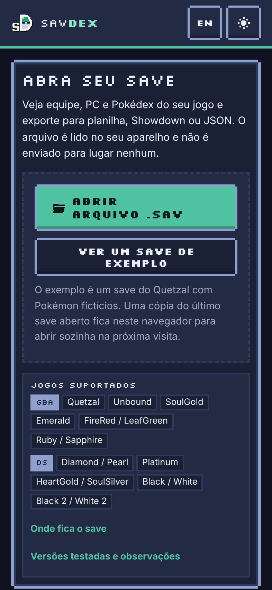
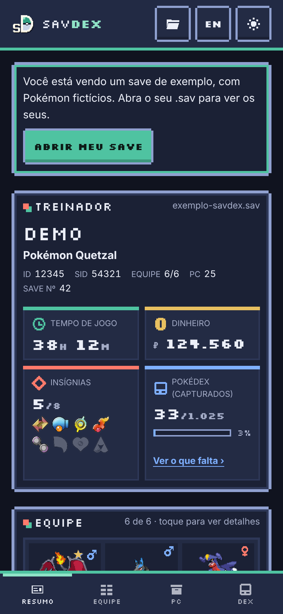
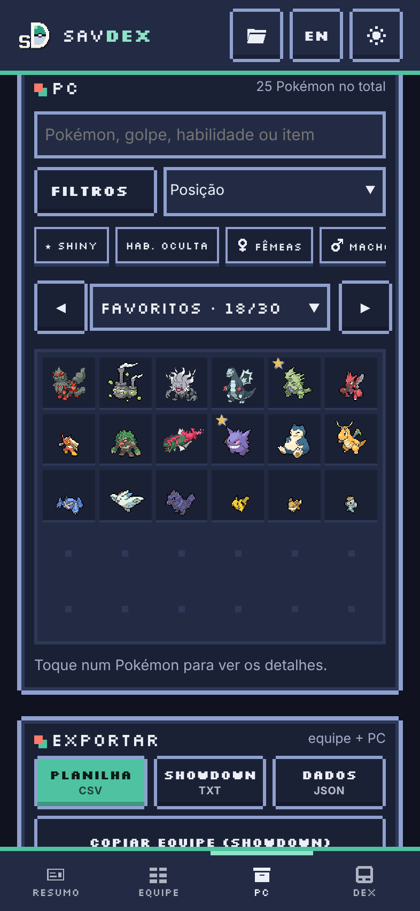
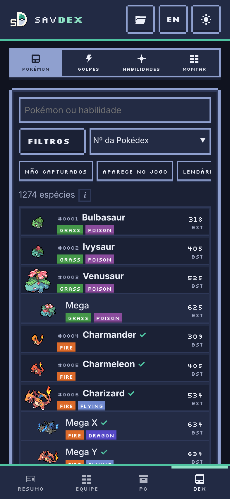
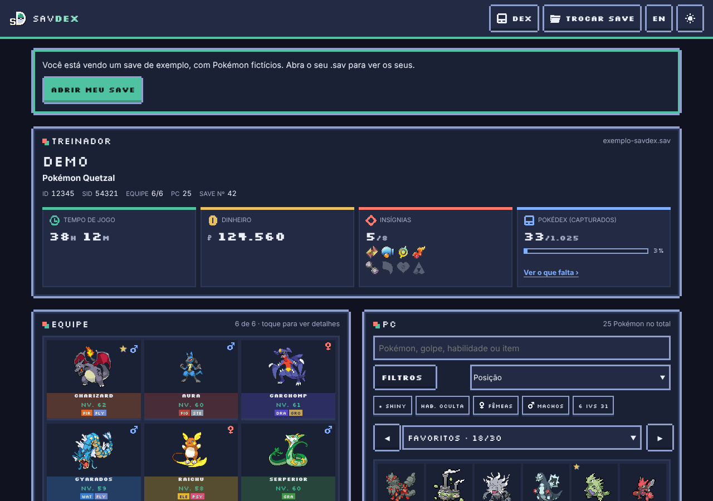
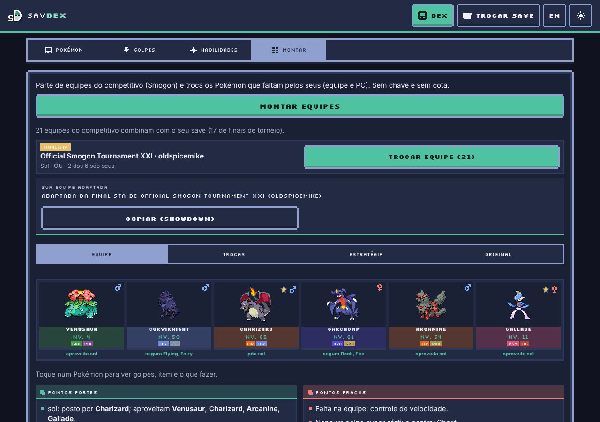

# savDex

**Abra o save do seu jogo de Pokémon no navegador e veja tudo o que tem nele.**

👉 **Acesse: <https://savdex.pages.dev/>**

O savDex lê o arquivo de save do emulador e mostra o treinador, a equipe e todas as caixas do PC, com stats, IVs, EVs, natureza, habilidade e golpes de cada Pokémon. Também tem uma Pokédex do jogo, um montador de equipes a partir das equipes do competitivo e exportação para planilha, Pokémon Showdown ou JSON.

Tudo roda no seu aparelho: o save **não é enviado para nenhum servidor**. Funciona no celular, no computador e offline depois da primeira visita (dá para instalar como app).

Não tem um save à mão? Toque em **Ver um save de exemplo** na tela inicial.

  
  
  
  

## Jogos suportados

| | Jogos |
|---|---|
| **ROM hacks** | Pokémon Quetzal, Pokémon Unbound, Pokémon SoulGold |
| **GBA** | Emerald, FireRed / LeafGreen, Ruby / Sapphire |
| **DS** | Diamond / Pearl, Platinum, HeartGold / SoulSilver, Black / White, Black 2 / White 2 |

Aceita o `.sav` do emulador, o `.dsv` do DeSmuME e os exports do GameShark/SharkPort (`.sps`) e do Action Replay DS (`.duc`). Todos os formatos foram conferidos com saves reais; um arquivo que não é de um jogo suportado mostra um aviso em vez de dados errados.

## O que dá para fazer

- **Resumo do save**: tempo de jogo, dinheiro, insígnias e Pokédex, com a lista do que ainda falta capturar (e quem você consegue evoluindo).
- **Equipe e PC**: uma caixa por vez, com o detalhe de cada Pokémon: stats, IVs, EVs, natureza, habilidade, Hidden Power, dano recebido por tipo, linha evolutiva e golpes que ele aprende.
- **Busca**: por nome, espécie, golpe, habilidade ou item em todas as caixas, com filtros (shiny, habilidade oculta, gênero, 6 IVs 31, tipo).
- **Análise da equipe**: fraquezas, resistências e cobertura dos golpes.
- **Dex**: Pokédex, golpes e habilidades do jogo do save, com filtros, comparação lado a lado e, no Quetzal, onde encontrar cada Pokémon no mapa.
- **Montar equipe**: parte de equipes reais do competitivo (Smogon, inclusive finais de torneio) e adapta com os Pokémon que você tem, dizendo o que ensinar, qual item dar e como a equipe joga.
- **O que mudou**: ao abrir o save de novo, mostra quem chegou, evoluiu, subiu de nível ou aprendeu golpes.
- **Equipes salvas** e **imagem da equipe** para compartilhar.
- **Exportar**: planilha (CSV), texto do Pokémon Showdown ou JSON.
- **Português e inglês** (botão EN/PT no topo).

  
  

## Privacidade

O save é lido no navegador. Uma cópia do último save fica guardada só no seu aparelho para abrir sozinha na próxima visita (dá para apagar). A única coisa que sai do aparelho é opcional: a parte "Com IA" do montador, que manda a lista dos Pokémon (nunca o arquivo) ao serviço que você escolher, com a sua própria chave.

---

Projeto de fã, sem vínculo com Nintendo, Game Freak, The Pokémon Company ou com os autores dos ROM hacks. Sprites do repositório [PokeAPI/sprites](https://github.com/PokeAPI/sprites). Os detalhes técnicos ficam em [`CLAUDE.md`](CLAUDE.md).
